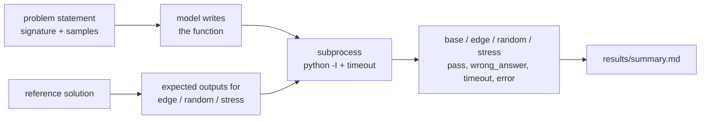

# cp-edgecase-bench

LLM-written code often passes the examples in the problem statement and then falls over on an empty list,
a single element, duplicates, or the max input size. This bench measures that gap.

Each of the 12 problems is judged twice, the same way [EvalPlus](https://github.com/evalplus/evalplus) does it
for HumanEval:

- **base**: only the sample tests shown in the problem statement
- **plus**: base + hand-picked edge cases + 40 random tests checked against a reference solution + max-size
  stress tests with a time limit

The difference between the two is how much of a model's "correct" code was only correct on the easy inputs.

## How it works



Model code runs in a separate `python -I` process in a temp dir, one process per test category, with a hard
timeout. That's isolation from crashes and infinite loops, **not** a security sandbox, so only use it with
mainstream models.

## Problems

max subarray, count inversions, merge intervals, longest substring without repeats, valid brackets,
min coins, spiral order, count primes, count pairs with sum, LIS length, integer to Roman, running median.

They're classic problems on purpose. The point isn't whether a model has seen them before, it's whether it
handles the edges and the limits stated in the docstring (e.g. `len(arr) <= 10^5` means O(n²) times out).

## Making sure the tests are right

If a reference solution is wrong, every score is wrong. So:

- `tests/test_references.py` checks each fast reference against a brute-force version on hundreds of random
  small inputs
- `cpbench check-refs` runs every reference through the same harness and timeouts the models get

```
ok  count_inversions  {'base': 'pass', 'edge': 'pass', 'random': 'pass', 'stress': 'pass'}
...
```

A correct-but-quadratic `count_inversions` gets `base/edge/random = pass, stress = timeout`, which is the
behaviour you want the bench to catch.

## Setup

Python 3.10+ and a free [Groq API key](https://console.groq.com/keys). No dependencies besides `pytest` for the
tests.

```powershell
# Windows PowerShell
$env:GROQ_API_KEY = "gsk_..."
```

```bash
# macOS / Linux
export GROQ_API_KEY="gsk_..."
```

## Run

```bash
python -m cpbench.cli check-refs
python -m cpbench.cli run
python -m cpbench.cli run --models groq:qwen/qwen3.8-27b --problems lis_length to_roman
python -m cpbench.cli run --samples 5      # sample at temperature 0.8 instead of one greedy answer
python -m cpbench.cli report
```

## Results

Run on 2026-10-21 via Groq, one greedy sample per problem (temperature 0). Raw outputs, including the code each model wrote, are in `results/*.json`.

**base** = passes the sample tests from the problem statement. **plus** = also passes edge cases, 40 random tests checked against a reference, and max-size stress tests.

| model | base pass@1 | plus pass@1 | base - plus |
|---|---|---|---|
| `allam-2-7b` | 25% | 0% | 25 pts |
| `openai_gpt-oss-120b` | 100% | 100% | 0 pts |
| `openai_gpt-oss-20b` | 100% | 100% | 0 pts |
| `qwen_qwen3.8-27b` | 100% | 92% | 8 pts |

### Per problem

| problem | `allam-2-7b` | `openai_gpt-oss-120b` | `openai_gpt-oss-20b` | `qwen_qwen3.8-27b` |
|---|---|---|---|---|
| max_subarray | ⚠️ edge (wrong_answer) | ✅ | ✅ | ✅ |
| count_inversions | ❌ base | ✅ | ✅ | ✅ |
| merge_intervals | ❌ base | ✅ | ✅ | ✅ |
| longest_unique_substring | ❌ base | ✅ | ✅ | ✅ |
| valid_brackets | ❌ base | ✅ | ✅ | ✅ |
| min_coins | ❌ base | ✅ | ✅ | ✅ |
| spiral_order | ❌ base | ✅ | ✅ | ✅ |
| count_primes | ❌ base | ✅ | ✅ | ✅ |
| count_pairs_with_sum | ⚠️ edge (wrong_answer) | ✅ | ✅ | ✅ |
| lis_length | ⚠️ edge (runtime_error) | ✅ | ✅ | ✅ |
| to_roman | ❌ base | ✅ | ✅ | ✅ |
| running_median | ❌ base | ✅ | ✅ | ⚠️ random (wrong_answer) |

### Where base-passing solutions broke

- `allam-2-7b`: edge: wrong_answer x2, edge: runtime_error x1
- `openai_gpt-oss-120b`: nothing
- `openai_gpt-oss-20b`: nothing
- `qwen_qwen3.8-27b`: random: wrong_answer x1

**What stands out**

- The gpt-oss models solved all 12 at full constraints, including the stress tests. Telling the model up front that hidden tests include max-size inputs seems to be enough for strong models to pick the O(n log n) approach.
- qwen3.8-27b passed every sample test, but its `running_median` broke on random inputs. That's the gap this bench is built to find: it would have looked 100% correct on the statement's examples.
- allam-2-7b (a 7B model) only got 3 of 12 past the samples and none past the full test set. Its `valid_brackets`, for example, never handles `(` at all.
- With one sample per problem this is a small run. `--samples 5` gives a more stable pass@1.

## Adding a problem

Add a reference function to `cpbench/problems.py` with the `@problem(...)` decorator: give it the prompt, the
sample tests, a list of edge cases, a random input generator and a stress input generator. Then add a
brute-force check to `tests/test_references.py`.

## Credits

The base vs. plus methodology is from *Is Your Code Generated by ChatGPT Really Correct?* (Liu et al.,
NeurIPS 2023) and the EvalPlus project (Apache 2.0). The problems, test generators and harness here are my own;
no EvalPlus code or data is included.

## License

MIT
